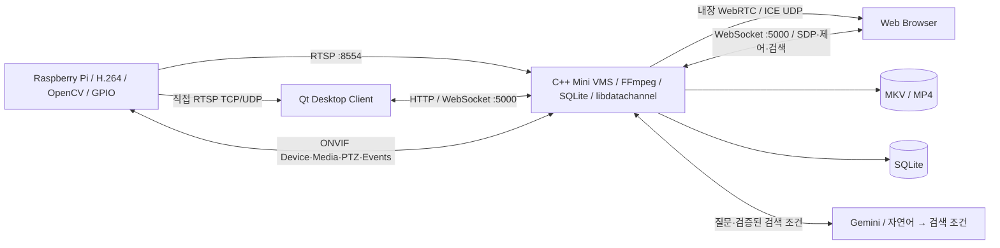
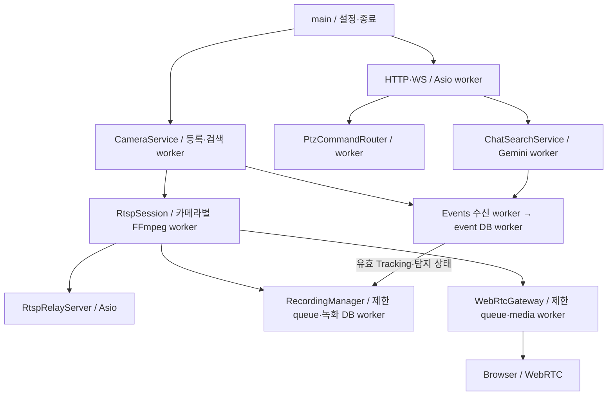

# Mini VMS Server

[문서 안내](docs/README.md) · [최신 전체 구조도](docs/SYSTEM_ARCHITECTURE.md)

Raspberry Pi Edge AI PTZ 카메라의 영상·제어·탐지 정보를 관리하는 C++17 서버 프로세스입니다. Qt GUI에 의존하지 않습니다. 현재 구성은 Qt의 Pi 직접 RTSP 라이브, VMS 내장 WebRTC를 통한 Web 라이브, PC 녹화·탐지/자연어 검색입니다.

## 전체 구조



PC MediaMTX 게이트웨이·WHEP는 제거했습니다. libdatachannel이 VMS 프로세스 안에서 ICE·DTLS·SRTP를 처리하며 FFmpeg가 받은 H.264를 재인코딩 없이 전달합니다. Pi의 MediaMTX RTSP 서버는 유지합니다. 녹화 재생은 Qt에만 제공하고 Web은 라이브·제어·검색·녹화 목록을 제공합니다.

## 구현 기능

| 영역 | 현재 구현 |
|---|---|
| 카메라 연동 | ONVIF Discovery, 서비스·프로파일·URI·좌표 공간 조회, cameraId별 관리 |
| RTSP | FFmpeg C API 수신, TCP/UDP 선택, timeout·재접속·RAII |
| RTSP 중계 | VMS :8555의 H.264 RTP TCP interleaved/UDP 중계 |
| WebRTC | 내장 libdatachannel, WebSocket SDP 교환, 세션별 peer·정지·재연결 |
| 녹화 | H.264 stream copy/remux, MKV/MP4, 기본 10분 segment, 완료 파일만 DB 등록 |
| 자동 녹화 | 자동 모드 ON + 확인된 Tracking ON + 사람 탐지에서 시작. 소실 후 10초 종료·재탐지 유지·수동 녹화 보호 |
| Events | PullPoint 구독·PullMessages·Renew·재연결·SOAP Fault 검사·중복 제거 |
| 메타데이터 | 실제 제공 필드만 저장·알림. 샘플링·보존 기간·탐지 색인 |
| 진단 | 마지막 수신/저장 시각, 저장된 탐지 샘플 수, 녹화·자동 모드 상태 |
| 검색 | 카메라·UTC 시간 범위·종류·최소 confidence·cursor |
| 자연어 검색 | Gemini → 허용된 JSON 조건 검증 → 실제 SQLite 조회 → 녹화 구간·추정 재생 위치 |
| PTZ·Tracking | 명령 순서·세션 소유권·최신 대기 이동·단절 Stop 시도. 접수/Pi 응답/실제 상태 구분 |

카메라 등록과 자동 모드 runtime 상태는 메모리에서 관리합니다. 재시작 후 등록과 설정을 다시 확인해야 합니다.

## 모듈과 비동기 처리



HTTP/WS는 비동기 I/O이고 FFmpeg·libcurl 등의 대기는 별도 작업 스레드에서 수행합니다. 모든 호출이 논블로킹이라는 의미는 아닙니다. 녹화 queue는 1,024개/16MiB, Events queue는 512개, WebRTC media queue는 256개/8MiB로 제한합니다. WebRTC peer는 최대 8개이고 library thread pool은 2개입니다. DB 연결은 각 worker가 소유하고 공유 snapshot은 mutex로 보호합니다.

```text
include/ · src/
├── camera/       # 검색·등록·상태·모듈 연결
├── stream/       # FFmpeg ingest / RTSP relay
├── recording/    # remux / 자동·수동 녹화 / queue
├── event/        # ONVIF 수신·검증·저장·진단
├── database/     # recordings / events / samples / anchors
├── onvif/        # HTTP Digest / SOAP / Events adapter
├── ptz/          # 순서·소유권·Stop / Tracking
├── webrtc/       # VMS 내부 H.264 WebRTC
├── chat/         # Gemini 조건 해석·검증·검색
├── client/       # HTTP / WebSocket API
└── core/         # 설정·UTC·로그
tools/            # 고정 WebRTC SDK 빌드
tests/            # unit / mock ONVIF·RTSP·Gemini / 실제 browser
docs/             # 계약·설계·검증
```

## 빌드와 실행

기본 dependency: FFmpeg libavformat/libavcodec/libavutil, Boost 1.70+, nlohmann_json, libcurl 7.85+, tinyxml2, SQLite3. 내장 WebRTC에는 OpenSSL과 libdatachannel 0.24.6 SDK가 필요합니다. 서버 경로에 libswscale은 사용하지 않습니다.

Linux/WSL:

```sh
sudo apt install build-essential cmake pkg-config git python3 libavformat-dev libavcodec-dev libavutil-dev libboost-dev nlohmann-json3-dev libcurl4-openssl-dev libtinyxml2-dev libsqlite3-dev libssl-dev
python3 tools/build-webrtc-sdk.py
cmake -S . -B build -DCMAKE_BUILD_TYPE=Debug -DCMAKE_PREFIX_PATH="$PWD/build/dependencies/webrtc-sdk"
cmake --build build --parallel 3
ctest --test-dir build --output-on-failure
cp config/vms.conf config/cam01.local.conf
./build/vms-server --config config/cam01.local.conf
```

기존 로컬 설정이 있으면 복사 명령을 다시 실행하지 않고 해당 파일을 사용합니다.

Windows native는 MSVC x64와 같은 compiler/architecture의 FFmpeg·libcurl·OpenSSL·libdatachannel SDK 및 CMake package가 필요합니다. 현재 VMS 빌드·WebRTC 검증 환경은 Linux/WSL입니다. SDK 없이 빌드하려면 -DVMS_ENABLE_WEBRTC=OFF를 사용하며 웹 라이브는 비활성화됩니다.

## 설정·주소

| 항목 | 기본 값 |
|---|---|
| Pi Device | http://192.168.0.92:8080/onvif/device_service |
| Pi 영상 / profile | rtsp://192.168.0.92:8554/cam / main |
| VMS HTTP / WS | http://127.0.0.1:5000 / ws://127.0.0.1:5000/ws |
| VMS RTSP 중계 | rtsp://<VMS 호스트>:8555/CAM01 |
| 내장 WebRTC 미디어 | ICE UDP 50000~50100 / SDP는 기존 WS |
| 녹화 | recording_root / recording_database / segment 600초 |
| 자동 녹화 | auto_recording_enabled=false / auto_recording_post_seconds=10 |
| 이벤트 | events_enabled=false / metadata_sample_ms=1000 |
| 자연어 검색 | chat_enabled=false / chat_model / chat_api_key_file |

설정 파일의 onvif_username/onvif_password를 사용하며 자격정보를 로그에 출력하지 않습니다. Gemini 키는 환경변수 또는 Git 제외 로컬 파일에서 읽습니다. config/*.local.conf, data, recordings, build는 커밋하지 않습니다. 공개 기본값과 개별 PC의 로컬 활성 설정은 다를 수 있습니다.

Qt/Windows ↔ WSL VMS의 RTSP UDP에는 실제 접근 가능한 WSL IP를 rtsp_relay_bind/rtsp_public_host로 설정해야 합니다. WebRTC도 SDP host 후보 주소와 ICE UDP 포트에 브라우저가 접근할 수 있어야 합니다. 기본은 같은 PC/LAN이고 STUN/TURN·외부 NAT·접근 인증 운영 설정은 후속 범위입니다.

## Client API

HTTP:

- GET /api/v1/cameras/{cameraId}/direct-stream?transport=tcp|udp: Qt용 Pi 직접 URI.
- GET /api/v1/cameras/{cameraId}/stream?transport=tcp|udp: VMS RTSP 중계 URI.
- 카메라 목록·상태는 현재 WebSocket을 사용하며 별도 REST 목록 endpoint는 없습니다.

WebSocket 요청은 version=1, 문자열 requestId, command, cameraId를 사용합니다.

| 명령 | 기능 |
|---|---|
| GET_CAMERA_LIST / GET_CAMERA_STATUS | 목록·capability·상태 |
| DISCOVER_CAMERAS / REGISTER_CAMERA | ONVIF 검색·등록 |
| PTZ_MOVE / PTZ_STOP / PTZ_CENTER | 수동 제어·정지·중앙 |
| TRACKING_ON / TRACKING_OFF | 현재 ONVIF 추적 제어 계약 |
| START_RECORDING / STOP_RECORDING / GET_RECORDINGS | 녹화 제어·완료 구간 조회 |
| SET_AUTO_RECORDING / GET_METADATA_STATUS | 자동 모드·수신/저장/녹화 진단 |
| GET_EVENTS / GET_DETECTIONS / GET_EVENT_PLAYBACK | 기록 검색·녹화 위치 조회 |
| CHAT_SEARCH | 자연어 조건 해석·검색·페이지·결과 선택 |
| GET_WEB_STREAM | native WebRTC 준비·신호 교환 방식 |
| WEBRTC_START / WEBRTC_ANSWER / WEBRTC_STOP | SDP offer/answer·세션 종료 |

PTZ 접수 ACCEPTED와 Pi ONVIF 응답 PI_ACKNOWLEDGED를 구분합니다. HTTP 성공은 모터 도착 완료가 아닙니다. 수동 MOVE는 약 200ms 갱신, Pi Timeout PT1S, VMS lease 600ms입니다.

## 시간·검색·재생 규칙

원본 시각과 VMS 수신 UTC milliseconds를 각각 보관합니다. 없는 필드는 null이고 frameId 등의 64bit 값은 문자열로 전달합니다. 상태 변경과 실시간 샘플은 구분하며 모든 bbox를 영구 저장하지 않습니다.

Gemini에는 질문·카메라 ID·시각·검증된 이전 조건만 전달하고 영상이나 녹화 경로를 보내지 않습니다. 임의 SQL을 실행하지 않습니다. 사람 탐지 기록 기반 검색이며 인물 식별·옷 색상·행동 검색은 제공하지 않습니다.

녹화 파일이 완료·존재하고 범위에 포함될 때만 playable=true입니다. 녹화 중은 RECORDING_IN_PROGRESS, 녹화가 없는 시각은 NO_RECORDING_AT_TIME으로 구분합니다. 현재 위치 연결은 receive_estimated이며 정확한 센서 캡처 프레임 동기화를 보장하지 않습니다. Qt의 2초 사전 재생 옵션은 이미 저장된 동일 파일 안에서만 적용합니다. 자동 녹화의 사전 녹화 버퍼는 없고 다음 keyframe부터 저장합니다.

## 문서·관련 저장소

[라이브 경로·WebRTC 빌드](docs/LIVE_ROUTING.md) · [자동 녹화](docs/AUTO_RECORDING.md) · [탐지·저장 진단](docs/DETECTION_SEARCH_READINESS.md) · [메타데이터 검색](docs/METADATA_VIDEO_SEARCH.md) · [자연어 검색](docs/CHAT_SEARCH.md) · [Tracking](docs/TRACKING_CONTROL.md) · [내장 WebRTC 선택](docs/tech-decisions/0002-native-webrtc.md)

[Pi / PTZ_CAMERA](https://github.com/PTZ-CAMERA/PTZ_CAMERA) · [Qt_Client](https://github.com/PTZ-CAMERA/Qt_Client) · [PTZ_WEB_Client](https://github.com/PTZ-CAMERA/PTZ_WEB_Client)

날짜별 세션 문서는 작성 당시 기록이며 현재 기능은 이 README와 소스를 기준으로 확인합니다.

## 코드 안내

DB 헤더는 include/database/에 두며 이전 event/EventRepository.h include는 호환 헤더로 유지합니다. 초기 추상 계약과 실제 실행 클래스를 구분하고 핵심 코드에 worker 소유권·수명·시간 기준을 설명했습니다. [CODE_GUIDE](docs/CODE_GUIDE.md)
