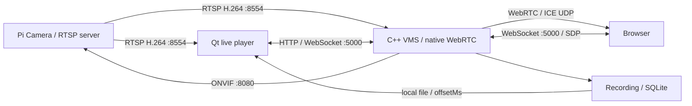

# 현재 라이브 영상 경로 (2026-10-11)

PC MediaMTX를 제거하고 C++ VMS 안에 libdatachannel WebRTC 미디어 전송을 연결했다. Pi의 MediaMTX RTSP 서버는 유지한다.



Qt 라이브는 Pi 직접 RTSP이고 Web 라이브는 VMS 직접 WebRTC이다. VMS RTSP relay :8555는 계속 제공하지만 WebRTC 입력으로 다시 RTSP를 연결하지 않는다. FFmpeg가 받은 AVPacket을 WebRtcGateway에 전달한다. 제어·메타데이터·녹화·검색은 VMS, 녹화 재생은 Qt에서 제공한다.

## Qt

`GET /api/v1/cameras/{cameraId}/direct-stream?transport=tcp|udp`를 사용한다.
기존 source=camera/protocol=rtsp 계약과 인증정보 표시 제거를 유지한다.

## Web

`GET_WEB_STREAM(cameraId)` 응답:

```json
{"cameraId":"CAM01","protocol":"webrtc","source":"vms","signaling":"websocket","ready":true,"gateway":"native"}
```

ready는 입력 준비이며 실제 재생 성공이 아니다. 브라우저가 decoded frame 증가를 확인한 후 LIVE로 표시한다.

1. WEBRTC_START(cameraId) → VMS가 ICE 후보를 수집하고 clientId/type=offer/sdp 반환.
2. 브라우저 RTCPeerConnection이 offer를 적용하고 answer·host ICE 후보 생성.
3. WEBRTC_ANSWER(cameraId,clientId,sdp) → VMS가 답변 적용. ANSWER_ACCEPTED는 재생 완료가 아니다.
4. WEBRTC_STOP 또는 WS 단절 → 해당 세션의 peer 해제.
5. WEBRTC_STATE 알림은 연결한 세션에만 전달된다. SDP나 인증정보를 방송하지 않는다.

한 WS 세션당 하나의 peer, 최대 8개, 연결 완료 대기 15초. 트리클 ICE·STUN/TURN은 현재 없다. Web은 외부 WHEP 주소·저장된 Pi WHEP 설정을 사용하지 않는다.

## 빌드·포트

OpenSSL 개발 패키지와 libdatachannel 0.24.6 SDK가 필요하다. 기존 Boost WebSocket을 사용하므로 library의 별도 WebSocket 기능은 빌드하지 않는다.

```sh
sudo apt install libssl-dev
python3 tools/build-webrtc-sdk.py
cmake -S . -B build -DCMAKE_PREFIX_PATH="$PWD/build/dependencies/webrtc-sdk"
cmake --build build --parallel 3
```

`-DVMS_ENABLE_WEBRTC=OFF`이면 SDK 없이 서버를 빌드할 수 있고 webRtcLive capability는 false이다. 실제 웹 라이브는 ON으로 빌드한다. Windows native SDK는 OpenSSL·nlohmann_json CMake package와 MSVC용 library 빌드가 필요하며 이번에는 WSL VMS에서 검증했다.

설정: webrtc_enabled=true, webrtc_port_begin=50000, webrtc_port_end=50100.
SDP 교환은 기존 TCP/HTTP WebSocket 5000. 영상은 VMS ICE UDP 50000~50100.
8889/8189 및 PC 게이트웨이는 사용하지 않는다. WSL에서는 host ICE 후보의 IP와 UDP 포트에 Windows 브라우저가 접근할 수 있어야 한다. 외부 NAT 연결에는 별도 STUN/TURN·HTTPS/WSS·접근 인증 설계가 필요하다.

## 검증

`python3 tests/native_webrtc_integration.py build/vms-server tests/fixtures/sample.h264 ../PTZ_WEB_Client`

합성 H.264 RTSP → 실제 VMS 내부 WebRTC → Chromium에서 1280×720 프레임 디코딩, 오류 없음, 정지·재연결을 확인했다. Pi 서비스·모터·장시간 시험은 자동 실행하지 않는다. [구현 선택과 한계](tech-decisions/0002-native-webrtc.md)
