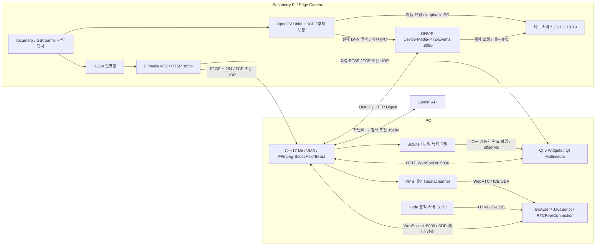

# 전체 시스템 구조

기준: 2026-10-11 작업 트리. 소스 구현, 설치된 실행 파일, 실물 검증 결과는 구분한다.

## 책임과 경로

| 구성 | 소유하는 기능 | 경계 |
|---|---|---|
| Pi | 캡처·H.264 인코딩·사람 탐지·추적·PWM·ONVIF | DB·녹화 검색·LLM은 PC 책임 |
| VMS | 수신·RTSP 중계·WebRTC·녹화·SQLite·ONVIF Client·검색 | GUI 없음. GPIO를 직접 제어하지 않음 |
| Qt | Pi 직접 RTSP·관제·PTZ 입력·검색·완료 파일 재생 | URI와 제어/검색 결과는 VMS에서 조회 |
| Web | VMS WebRTC·PTZ 입력·검색·녹화 제어/목록 | 녹화 영상 재생 UI는 제공하지 않음 |
| Gemini | 자연어를 제한된 검색 조건으로 변환 | 영상 분석·SQL 실행·파일 선택은 맡기지 않음 |

Pi MediaMTX는 **현재 사용하는 RTSP 서버**다. PC MediaMTX/WHEP는 사용하지 않는다.
VMS RTSP 중계 :8555는 별도로 유지되지만 현재 Qt 기본 라이브와 WebRTC 입력 경로는 아니다.
ONVIF Events는 제조사 확장 탐지·추적 정보를 전달한다. 표준 Profile M 전체 지원을 의미하지 않는다.

## 주소와 포트

| 경로 | 기본 포트 / 전송 | 주의점 |
|---|---|---|
| Pi RTSP | 8554 TCP; Pi RTP/RTCP 8000/8001 UDP | RTSP URI가 같아도 TCP/UDP 미디어 경로는 다름 |
| Pi ONVIF / 검색 | 8080 TCP/HTTP; 3702 UDP | WS-Discovery는 LAN 범위 |
| Pi 내부 서보 IPC | loopback 5000 TCP | PC VMS의 5000 포트와 다른 호스트/용도 |
| VMS API | 5000 TCP / HTTP·WebSocket | 목록·상태는 WS, stream URI는 REST |
| VMS RTSP relay | 8555 TCP + 협상된 UDP 경로 | WSL localhost TCP 전달만으로 UDP 경로가 보장되지 않음 |
| VMS WebRTC | ICE UDP 50000–50100 | SDP는 기존 WS. 실제 접근 가능한 후보 주소 필요 |
| Web 정적 파일 | 5173 HTTP | Node 서버는 영상·PTZ 서버가 아님 |

실제 주소·인증은 로컬 설정을 기준으로 한다. 소스 문서에 비밀번호나 API 키를 넣지 않는다.

## 저장소

[Pi](https://github.com/PTZ-CAMERA/PTZ_CAMERA) ·
[VMS](https://github.com/PTZ-CAMERA/PTZ_VMS_Server) ·
[Qt](https://github.com/PTZ-CAMERA/Qt_Client) ·
[Web](https://github.com/PTZ-CAMERA/PTZ_WEB_Client)
