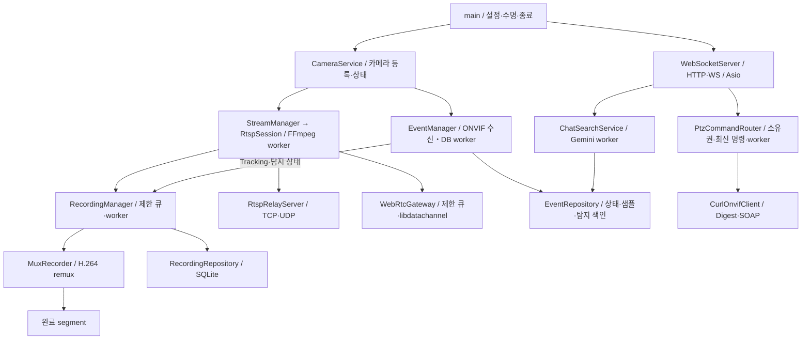

# Mini VMS 현재 아키텍처

2026-10-11 작업 트리 기준. [전체 시스템 구조](SYSTEM_ARCHITECTURE.md)

## 실행 구성

## 스레드·큐·자원

- FFmpeg 수신은 카메라별 worker에서 수행하며 패킷 수명을 소유한 작업으로 각 소비자에 전달한다.
- 녹화 worker는 muxer와 녹화 DB를 소유한다. 영상 대기는 1,024개/16MiB 상한 검사,
  명령은 별도 64개 제한이다. 영상 초과 시 대기 패킷을 비우고 명령을 보존하며 다음 keyframe에서
  구간을 다시 시작한다. 이때 녹화 공백이 생길 수 있으며 무손실 녹화를 보장하지 않는다.
- Events 수신과 DB 처리를 분리하고 queue를 제한한다. 원본 UTC와 VMS 수신 UTC를 각각 저장한다.
- HTTP/WS는 Asio 비동기 I/O다. libcurl·FFmpeg 대기 자체를 모두 비동기 API로 바꾼 것은 아니다.
- WebRTC는 제한된 media queue와 worker를 사용한다. SDP 교환은 WS, 미디어는 libdatachannel이다.
- PTZ는 카메라별 순서를 관리하며 대기 이동을 최신 요청으로 교체한다. 다른 WS 세션의 요청은
  `PTZ_BUSY`가 될 수 있다. 접수, Pi 응답, 실제 모터 도착은 서로 다른 의미다.

## 저장·검색

`RecordingRepository`는 완료된 파일 구간을, `EventRepository`는 상태 이벤트·metadata sample·
탐지 색인과 녹화 연결 정보를 관리한다. `ChatSearchService`가 Gemini 조건을 검증한 뒤 같은
조회 경로를 사용한다. 없는 녹화를 playable로 만들지 않는다. 현재 offset은 수신 시각 기반
`receive_estimated`이며 정확한 센서 프레임 시각 동기화가 아니다.

## 디렉토리와 계약

실행 코드는 `src/`, 공개 계약은 대응하는 `include/` 모듈, 검증은 `tests/`, SDK 준비는 `tools/`다.
초기 추상 `CameraManager`, `DatabaseManager`, `PlaybackManager`를 실제 runtime manager로
혼동하지 않는다. 실제 조립은 `CameraService`와 위 manager/repository가 담당한다.
빌드·설정·포트는 [README](../README.md), API와 운영 문서 목록은 [문서 안내](README.md)를 따른다.

기존 CMake·include·설정·서비스 경로를 보존한다. 생성물은 `build/`, DB는 `data/`, 영상은
`recordings/`, 비공개 설정은 `config/*.local.conf`로 분리되어 Git에서 제외된다.
